---
# Charla de divulgación para visitas de institutos (14–18 años) al ICMM-CSIC.
# 10–15 min de charla y después dos demostraciones del efecto Meissner (imán levitando y
# tren levitante, con un cuprato, imanes de neodimio y nitrógeno líquido).
# Contenido a partir de Visitas-Superconductividad-2026.pptx (carpeta superior).
title: "Cuando los electrones bailan juntos"
affiliation: "Instituto de Ciencia de Materiales de Madrid (ICMM-CSIC)"
event: "Superconductividad"
hero:
  - src: assets/img/title_art.svg
    class: full
logos:
  - assets/private/logo_csic.svg
  - assets/private/logo_icmm.svg
logo: assets/private/logo_csic.svg
footer: "Superconductividad · Visitas al ICMM-CSIC"
lang: es
format:
  divulga-revealjs:
    css: assets/css/talk.css
    include-after-body: assets/includes/after-body.html
---

## {#hook .hook .no-kicker}

::: {.hook-body}
[La mecánica cuántica manda en el mundo de los átomos. A nuestra escala, casi nunca se nota.]{.hook-lead}

[¿Podemos ver la mecánica cuántica a simple vista?]{.hook-q}
:::

::: {.notes}
(0:40) [Portada] Presentarse: nombre y qué investigas en el ICMM, que es un centro del CSIC.
Hoy vamos a hablar de superconductores: qué son, por qué existen y para qué sirven. Y al
final los vais a ver funcionar delante de vosotros.

[Esta diapositiva] La mecánica cuántica explica los átomos, los electrones y la luz, y es
muy rara: partículas que son ondas, cosas que están en dos sitios a la vez. Pero en la vida
diaria no la vemos: una pelota no se comporta como una onda. La pregunta de hoy: ¿hay algún
caso en el que la cuántica se vea a simple vista, a nuestra escala? Al final, antes de las
demostraciones, tendréis la respuesta. (No adelantar lo que se verá en la demostración.)
:::

## En 1911, la resistencia del mercurio cayó de golpe a cero {data-kicker="01 · El descubrimiento"}

:::: {.columns}
::: {.column width="38%"}
::: {.photo}
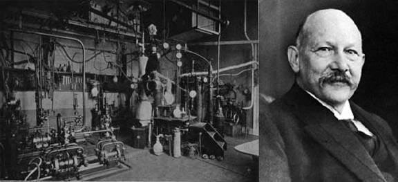
:::

[Heike Kamerlingh Onnes en su laboratorio de Leiden (Países Bajos)]{.figcap}

::: {.timeline}
[1908]{.yr}

Consigue helio líquido: −269 °C

[1911]{.yr}

Enfría mercurio y su resistencia desaparece
:::
:::
::: {.column width="58%"}
::: {.qm-widget data-widget="rt" data-w="820" data-h="620" style="width:820px;height:620px"}
:::
:::
::::

[]{.fragment .qm-step}

::: {.enclase}
En clase: [1º Bach · Temperatura absoluta (K)]{.chip} [2º Bach · Límites de la física clásica]{.chip}
:::

::: {.notes}
(1:10) Onnes fue el primero en licuar helio, en 1908. Con eso podía enfriar cosas hasta
4 kelvin: 4 grados por encima del cero absoluto, que son −273 °C. Nadie había llegado tan
abajo. Y lo primero que hizo fue medir cómo conduce la electricidad un metal muy frío.

Lo esperado (línea gris): que la resistencia bajara poco a poco al enfriar.
[click] Lo que midió en el mercurio: al llegar a 4,2 K la resistencia cae de golpe a cero.
No a casi cero: a cero, por debajo de lo que podía medir. A esa temperatura la llamamos
temperatura crítica, T_c. Ganó el Nobel en 1913.

(Si preguntan por la escala Kelvin: es la de Celsius desplazada 273 grados; 0 K es lo
más frío que puede existir.)
:::

## Un superconductor tiene dos superpoderes {data-kicker="01 · El descubrimiento"}

::: {.powers}
::: {.card .power}
[1 · Resistencia cero]{.card-h}

::: {.qm-widget data-widget="rings" data-w="640" data-h="380" style="width:640px;height:380px"}
:::

::: {.fragment .qm-step}
Sin resistencia no se pierde energía en calor, [$P = I^2 R = 0$]{.nowrap}: la corriente gira **sin pila, durante años**
:::
:::

::: {.card .power .fragment .qm-step}
[2 · Efecto Meissner (1933)]{.card-h}

::: {.qm-widget data-widget="meissner" data-w="620" data-h="330" data-cold="3" style="width:620px;height:330px"}
:::

Por debajo de $T_c$, el superconductor **expulsa el campo magnético** de su interior
:::
:::

[]{.fragment .qm-step}

::: {.enclase}
En clase: [1º Bach · Potencia y rendimiento]{.chip} [2º Bach · Inducción: ley de Lenz]{.chip}
:::

::: {.notes}
(1:30) Dos propiedades, y las dos las veréis al final.

Primera: resistencia cero. A la izquierda, un anillo de metal normal: para que haya
corriente hace falta una pila, y los electrones chocan y lo calientan (destellos naranjas).
Si quitamos la pila, la corriente se para enseguida.
[click] A la derecha, un anillo superconductor: sin pila, la corriente sigue girando. Si
R = 0, la potencia que se pierde en calor, I²R, es cero. En los años 50, S. C. Collins
mantuvo una corriente así durante dos años y medio sin medir ninguna pérdida; paró porque
se acabó el helio.

[click] Segunda: el efecto Meissner, de 1933. Caliente, el material es normal y el campo
magnético lo atraviesa. [click] Al enfriarlo por debajo de T_c, el campo se queda fuera:
las líneas lo rodean. (Qué consecuencias tiene, mejor que lo descubran en la demostración.)

Ojo: esto no es la resistencia cero llevada al extremo, es una propiedad distinta. (Los
botones Caliente/Frío sirven para repetirlo si hay preguntas.)
:::

## La resistencia es el rozamiento de los electrones {data-kicker="02 · ¿Por qué ocurre?"}

:::: {.columns}
::: {.column width="55%"}
::: {.qm-widget data-widget="scatter" data-w="790" data-h="440" style="width:790px;height:500px"}
:::
:::
::: {.column width="41%"}
::: {.photo .disco}
<video data-autoplay loop muted playsinline poster="assets/video/baile_choques_poster.jpg" src="assets/video/baile_choques.mp4"></video>
:::

::: {.vcap}
[Como cruzar una pista llena: todos se mueven y chocan]{.figcap}
[Vídeo: Koffermejia, CC0]{.credit}
:::

::: {.items .compact}
::: {.item}
[+]{.ico}

::: {.txt}
Iones de la red, que vibran más cuanto más calor hace
:::
:::

::: {.item}
[×]{.ico .ink}

::: {.txt}
Impurezas y defectos del material
:::
:::

::: {.item}
[−]{.ico .red}

::: {.txt}
Electrones
:::
:::
:::
:::
::::

[]{.fragment .qm-step}

::: {.key .orange .fragment .fade-up}
Cada choque calienta el cable (efecto Joule). ¿Por qué se calienta el cargador del móvil?
:::

::: {.enclase}
En clase: [1º Bach · Enlace metálico]{.chip} [1º Bach · Rozamiento y degradación de la energía]{.chip}
:::

::: {.notes}
(1:10) En un metal, los electrones de fuera de cada átomo quedan libres y forman un "mar"
entre los iones positivos (enlace metálico). Cuando enchufamos una pila, avanzan, pero
chocan con los iones, que vibran más cuanto más caliente está el metal, con impurezas y
defectos, y entre ellos.

Es como cruzar una pista de baile llena (el vídeo): todos se mueven a la vez, cada uno a
su aire, y no hay forma de avanzar sin chocar. Los destellos naranjas son esos choques: energía que se pierde en calor.
[click] Subimos la temperatura: los iones vibran más y hay muchos más choques. (El
deslizador sigue activo para las preguntas.)

[click] Pregunta: ¿por qué se calienta el cargador del móvil? Por esto mismo: efecto
Joule.
:::

## Por debajo de $T_c$, los electrones bailan en pareja {data-kicker="02 · ¿Por qué ocurre?"}

:::: {.columns .v-center}
::: {.column width="54%"}
::: {.photo}
<video data-autoplay loop muted playsinline poster="assets/video/baile_pareja_poster.jpg" src="assets/video/baile_pareja.mp4"></video>
:::

::: {.vcap}
[En pareja y todos con el mismo paso]{.figcap}
[Vídeo: Sdkb, CC BY-SA 4.0]{.credit}
:::
:::
::: {.column width="42%"}
[Por debajo de la temperatura crítica, los electrones se juntan en **pares de Cooper** y se mueven coordinados, **sin chocar**.]{.bignote}

[Teoría BCS (Bardeen, Cooper y Schrieffer, 1957) · Premio Nobel en 1972]{.figcap}

::: {.fragment .fade-up}
::: {.key}
Pero… ¡los electrones se repelen! ¿Qué los mantiene juntos?
:::
:::
:::
::::

::: {.enclase}
En clase: [2º Bach · Ley de Coulomb]{.chip}
:::

::: {.notes}
(0:50) La explicación llegó 46 años después, en 1957: la teoría BCS, por las iniciales
de sus autores. Al enfriar, los electrones se juntan de dos en dos, en pares de Cooper, y
se mueven de forma coordinada. Si todos bailan por parejas y siguiendo el mismo ritmo,
nadie choca con nadie.

[click] Pero aquí hay un problema: dos electrones tienen carga negativa y se repelen
(Coulomb). ¿Qué puede unirlos?
:::

## La red de iones hace de pegamento entre dos electrones {data-kicker="02 · ¿Por qué ocurre?"}

::: {.qm-widget data-widget="glue" data-w="1440" data-h="390" style="width:1440px;height:390px"}
:::

::: {.nsteps}
::: {.item .fragment .qm-step}
[1]{.ico .num .red}

::: {.txt}
Un electrón pasa y atrae a los iones positivos
:::
:::

::: {.item .fragment .qm-step}
[2]{.ico .num .orange}

::: {.txt}
Los iones, lentos, reaccionan tarde: queda una estela positiva
:::
:::

::: {.item .fragment .qm-step}
[3]{.ico .num .red}

::: {.txt}
Un segundo electrón cae hacia esa estela
:::
:::

::: {.item .fragment .qm-step}
[4]{.ico .num}

::: {.txt}
Ya forman un par de Cooper y viajan juntos
:::
:::
::::

::: {.enclase}
En clase: [1º Bach · Fuerza elástica (Hooke)]{.chip} [2º Bach · Movimiento armónico simple]{.chip}
:::

::: {.notes}
(1:30) El pegamento es la propia red de iones.
[click] Un electrón pasa y tira de los iones positivos que tiene cerca.
[click] Los iones pesan miles de veces más que un electrón y son lentos: cuando se han
desplazado, el electrón ya está lejos. Detrás queda una zona con más carga positiva, una
estela.
[click] Un segundo electrón es atraído por esa estela.
[click] Ya están unidos: un par de Cooper. Los dos electrones no se tocan, pero viajan
juntos, unidos a través de la red, que va deformándose a su paso. (Ojo si preguntan: en
un par real los dos electrones están muy lejos, a cientos de átomos; el dibujo lo encoge.)

Analogía: dos bolas sobre una cama elástica. Cada una hunde la lona y la otra rueda hacia
el hueco.

Los iones están unidos como por muelles; sus vibraciones, que en cuántica vienen en
paquetes, se llaman fonones. Decimos que los electrones se atraen "intercambiando fonones".
:::

## Todos los pares bailan la misma coreografía {data-kicker="02 · ¿Por qué ocurre?"}

::: {.qm-widget data-widget="dance" data-w="1440" data-h="370" style="width:1440px;height:370px"}
:::

::: {.nsteps}
::: {.item .fragment .fade-up}
[1]{.ico .num}

::: {.txt}
[Una sola onda]{.it}
Billones de pares comparten el mismo estado cuántico
:::
:::

::: {.item .fragment .fade-up}
[2]{.ico .num}

::: {.txt}
[Sin resistencia]{.it}
Una impureza no puede frenar a una pareja sin frenar a todo el salón
:::
:::

::: {.item .fragment .fade-up}
[3]{.ico .num}

::: {.txt}
[Hace falta frío]{.it}
El calor rompe las parejas: por encima de $T_c$ se acaba el baile
:::
:::
::::

::: {.enclase}
En clase: [1º Bach · Momento lineal]{.chip} [2º Bach · Dualidad onda-partícula]{.chip}
:::

::: {.notes}
(1:00) Aquí está lo cuántico. En un metal normal, cada electrón va a lo suyo. En un
superconductor, todas las parejas hacen el mismo paso a la vez.
[click] Billones de pares descritos por una única onda: la dualidad onda-partícula, pero a
escala de un objeto que podéis ver.
[click] Por eso no hay resistencia: para frenar a una pareja habría que frenar a todas a
la vez, y una impureza no puede.
[click] Y por eso hace falta frío: la agitación térmica rompe las parejas. Por encima de
T_c, se acabó el baile.
:::

## Desde 1986 basta con nitrógeno líquido, que es barato {data-kicker="03 · ¿Para qué sirve?"}

:::: {.columns}
::: {.column width="68%"}
::: {.qm-widget data-widget="tc" data-w="980" data-h="600" style="width:980px;height:600px"}
:::
:::
::: {.column width="28%"}
[]{.fragment .qm-step}
[]{.fragment .qm-step}

::: {.key .navy .fragment .qm-step}
**Un misterio abierto.** Todavía no sabemos explicar del todo los cupratos ni los de hierro
:::

::: {.key .orange .fragment .qm-step}
**Hidruros.** Casi a temperatura ambiente… pero apretados a más de un millón de atmósferas
:::
:::
::::

::: {.enclase}
En clase: [1º Bach · Presión]{.chip} [2º Bach · Fronteras de la física]{.chip}
:::

::: {.notes}
(1:10) El gran problema es el frío. Las líneas marcan cómo enfriamos: helio líquido
(−269 °C, caro y escaso), nitrógeno líquido (−196 °C, barato: más o menos lo que cuesta
la leche) y temperatura ambiente, el sueño.
[click] Durante 75 años, los superconductores conocidos necesitaban helio.
[click] En 1986 llegan los cupratos, cerámicas de cobre y oxígeno, y en 1987 el YBCO
supera los −196 °C: ya basta con nitrógeno. Es el que vais a ver hoy (T_c = 92 K, −181 °C).
[click] Después, los de hierro (2008) y el grafeno rotado (2018). Los cupratos y los de
hierro no se explican del todo con BCS: es uno de los grandes problemas abiertos de la
física.
[click] Los hidruros rozan la temperatura ambiente, pero solo apretados a más de un millón
de atmósferas, entre dos diamantes. No sirven para un cable.
(Puntos huecos: a alta presión. Récord a presión normal: cupratos de mercurio, −140 °C.)
:::

## Ya hay superconductores en hospitales, aceleradores y trenes {data-kicker="03 · ¿Para qué sirve?"}

::: {.apps}
::: {.app}
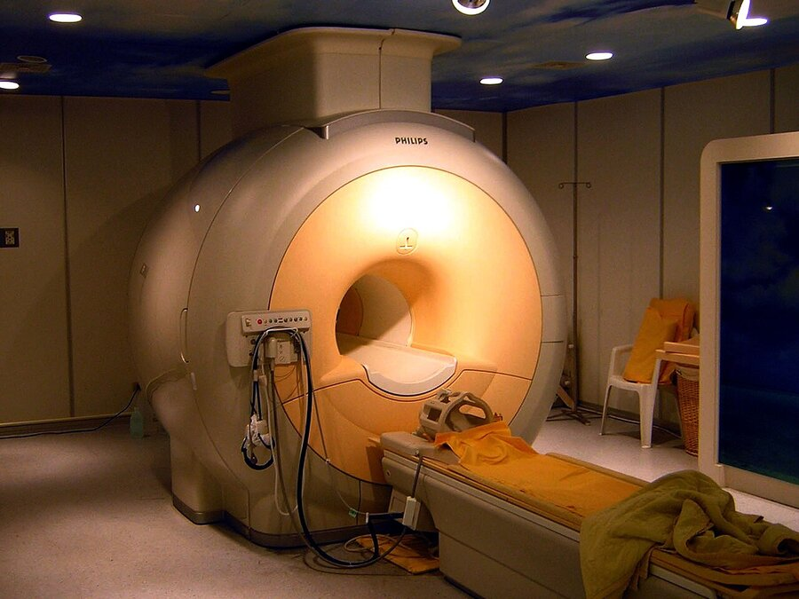

[Resonancia magnética]{.app-h}
[Imanes 60.000 veces más fuertes que el campo de la Tierra]{.app-t}
[Foto: KasugaHuang, CC BY-SA 3.0]{.credit}
:::

::: {.app}
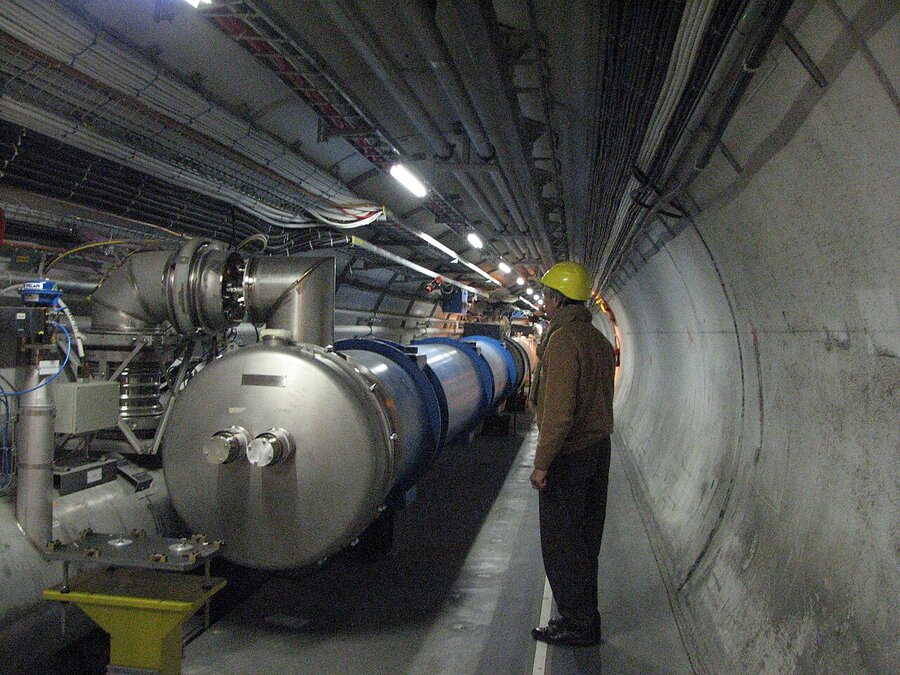

[Acelerador LHC (CERN)]{.app-h}
[1.232 imanes superconductores curvan los protones]{.app-t}
[Foto: Muriel, CC BY-SA 2.0]{.credit}
:::

::: {.app}
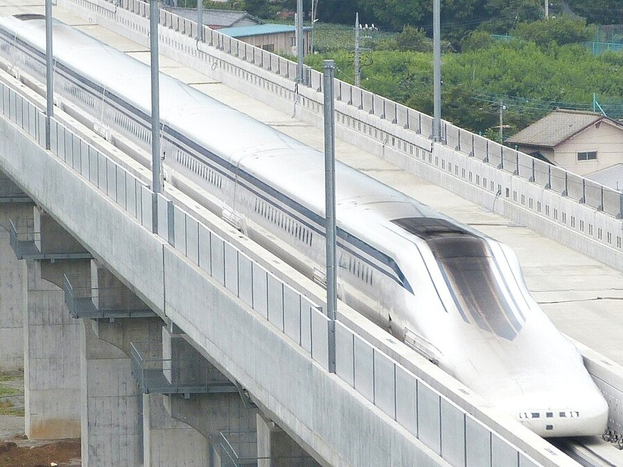

[Trenes que levitan]{.app-h}
[Récord: 603 km/h (Japón, 2015)]{.app-t}
[Foto: Hisagi, CC BY-SA 4.0]{.credit}
:::

::: {.app}
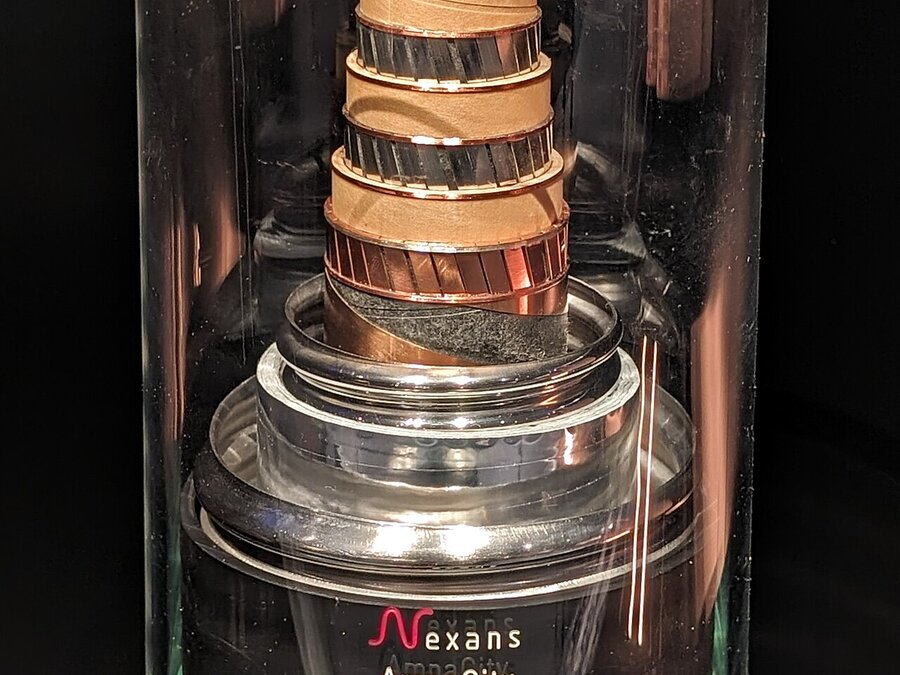

[Cables sin pérdidas]{.app-h}
[En Essen (Alemania), 1 km de cable superconductor lleva luz a la ciudad desde 2014]{.app-t}
[Foto: The wub, CC BY-SA 4.0]{.credit}
:::
:::

::: {.key .navy}
El truco casi siempre es el mismo: sin resistencia se fabrican **imanes muy potentes que no gastan energía**
:::

::: {.enclase}
En clase: [2º Bach · Campo de un solenoide]{.chip} [2º Bach · Fuerza de Lorentz]{.chip}
:::

::: {.notes}
(1:00) Casi todas las aplicaciones usan la resistencia cero para hacer electroimanes muy
potentes: una bobina por la que circula muchísima corriente sin calentarse.

Resonancia magnética: el imán del hospital tiene unos 3 teslas, 60.000 veces el campo de
la Tierra. Si os habéis hecho una resonancia, habéis estado dentro de un superconductor.
LHC, en el CERN (Ginebra): 27 km de túnel y 1.232 imanes que curvan los protones; los
enfrían a −271 °C. El tren japonés SCMaglev: levita con imanes superconductores y batió
el récord de 603 km/h en 2015. Y cables: en Essen (Alemania) un kilómetro de cable
superconductor, enfriado con nitrógeno, reparte electricidad sin perder energía en calor.
:::

## Muchos ordenadores cuánticos usan superconductores {data-kicker="03 · ¿Para qué sirve?"}

:::: {.columns .v-center}
::: {.column width="44%"}
::: {.photo}
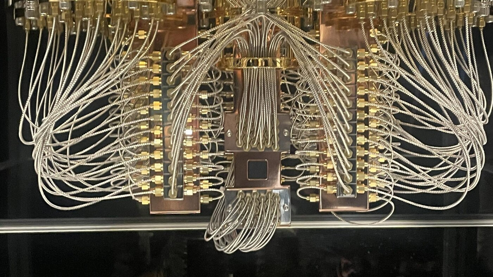
:::

[Dentro de la «nevera»: el chip va abajo del todo]{.figcap}
:::
::: {.column width="52%"}
::: {.items}
::: {.item}
[]{.ico}

::: {.txt}
[Del bit al cúbit]{.it}
Un cúbit puede ser 0 y 1 a la vez: superposición
:::
:::

::: {.item}
[]{.ico .red}

::: {.txt}
[Hecho de superconductor]{.it}
Pares de Cooper que cruzan por efecto túnel una unión Josephson
:::
:::

::: {.item}
[]{.ico}

::: {.txt}
[A 0,01 K]{.it}
El calor destruye la superposición: hay que enfriar más que el espacio exterior (2,7 K)
:::
:::
:::

::: {.key .plain}
Siendo sinceros: hoy son prototipos. Los grandes y fiables llegarán hacia 2030 o más tarde
:::
:::
::::

::: {.enclase}
En clase: [1º Bach · Temperatura absoluta]{.chip} [2º Bach · Cuantización]{.chip}
:::

::: {.notes}
(0:50) Otra aplicación, más reciente. Un ordenador normal usa bits: 0 o 1. Un ordenador
cuántico usa cúbits, que pueden estar en 0 y en 1 a la vez. Con N cúbits se manejan 2^N
combinaciones a la vez: con 300 cúbits, más que átomos hay en el universo.

Los cúbits de IBM o Google son pequeños circuitos superconductores: los pares de Cooper
cruzan por efecto túnel una barrera aislante (una unión Josephson) y el circuito se
comporta como un "átomo artificial". Hay que enfriarlos a 0,01 K, porque el calor destruye
la superposición. La foto es la "nevera": cada piso está más frío que el de arriba.

Siendo sinceros: hoy son prototipos con errores; los útiles a gran escala tardarán años.
:::

## En los de tipo II, los vórtices dejan el imán atrapado en el aire {data-kicker="04 · En directo"}

:::: {.columns}
::: {.column width="52%"}
::: {.qm-widget data-widget="vortex" data-w="760" data-h="560" style="width:760px;height:560px"}
:::
:::
::: {.column width="44%"}
[Los de tipo II dejan pasar algunas líneas de campo, encerradas en tubitos llamados **vórtices**.]{.lead}

::: {.items .fragment .qm-step}
::: {.item}
[]{.ico}

::: {.txt}
[Anclados]{.it}
Los vórtices se enganchan en los defectos del material
:::
:::

::: {.item}
[]{.ico .red}

::: {.txt}
[El imán queda atrapado]{.it}
Ni se cae ni se escapa: levita estable… ¡incluso boca abajo!
:::
:::
:::

::: {.vortex-img .fragment .fade-up}
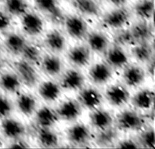

[Vórtices vistos al microscopio (cada mancha oscura es uno). Imagen: Isabel Guillamón (UAM)]{.figcap}
:::
:::
::::

::: {.enclase}
En clase: [2º Bach · Flujo magnético]{.chip} [2º Bach · Inducción: ley de Lenz]{.chip}
:::

::: {.notes}
(0:50) El YBCO es un superconductor de tipo II. Con el efecto Meissner puro, el campo
quedaría todo fuera y el imán resbalaría hacia un lado y se caería.
[click] Pero en los de tipo II algunas líneas de campo atraviesan el material por tubitos
muy finos, los vórtices, alrededor de los cuales gira una corriente. Esos vórtices se
quedan enganchados en los defectos del material: el imán queda "clavado" en el aire. Por
eso podremos inclinarlo, darle la vuelta y empujarlo sin que se caiga.
[click] Así se ven los vórtices con un microscopio: una red de manchas, cada una un tubito
de campo magnético.
:::

## Tres ideas para llevaros {.no-kicker}

::: {.ccards}
::: {.ccard}
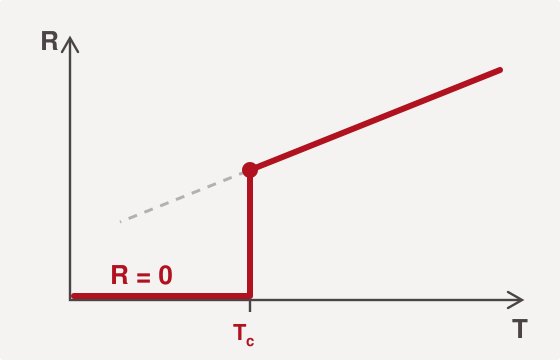

#### Dos superpoderes

Por debajo de $T_c$ la corriente no pierde energía y el campo magnético se queda fuera
:::

::: {.ccard .fragment .fade-up}
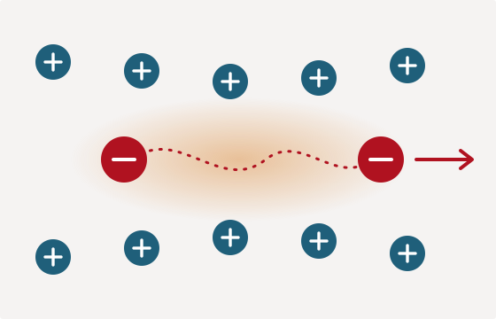

#### Un baile cuántico

Billones de electrones bailan en pareja, todos a la vez y con el mismo paso
:::

::: {.ccard .fragment .fade-up}
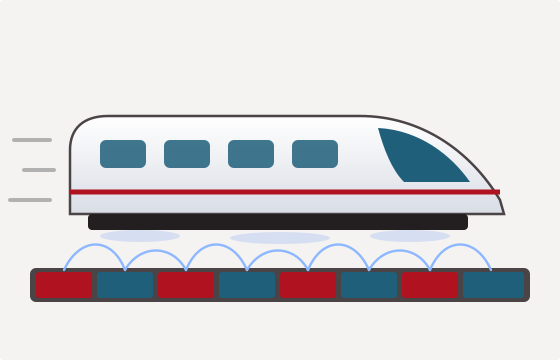

#### Ya están en tu vida

En hospitales, en el CERN, en trenes y en los ordenadores cuánticos
:::
:::

::: {.key .fragment .fade-up}
**¿Podemos ver la cuántica a simple vista?** Sí: en un superconductor, billones de electrones forman una sola onda cuántica. Ahora lo vais a ver
:::

::: {.notes}
(0:40) Resumen en tres ideas. [click] [click] [click] Y la respuesta a la pregunta del
principio: sí, la cuántica se puede ver a simple vista. En un superconductor, billones de
electrones se comportan como una sola onda cuántica, y eso es lo que vais a ver ahora,
encima de la mesa.
:::

## ¡Gracias! {.no-kicker .no-logo .thanks}

:::: {.columns .v-center}
::: {.column width="52%"}
::: {.photo-map}
{.photo}

::: {.map-box}

[Madrid]{.map-pin style="left:45.6%;top:43.9%"}
:::
:::

[Instituto de Ciencia de Materiales de Madrid (ICMM-CSIC), en Cantoblanco]{.figcap}
:::
::: {.column width="42%"}
::: {.more}
[Para saber más]{.more-h}

[wp.icmm.csic.es/superconductividad]{.more-web}

[\@supercond_icmm]{.more-social}
[\@icmm_csic]{.more-social}
:::
:::
::::

::: {.funding}
::: {.inst}
 
:::

[Gracias al personal y a la comisión de divulgación del ICMM]{.thanks-to}
:::

::: {.notes}
(0:20) En el ICMM estudiamos materiales superconductores y cuánticos. Si os ha gustado, en la
web y en redes hay más. Y ahora, lo prometido: vamos a verlo.
:::

## Ahora, en directo: apostad antes de mirar {data-kicker="04 · En directo"}

::: {.demo}
::: {.dcard}
[]{.ico}

::: {.txt}
[Nitrógeno líquido]{.it}
A −196 °C hierve sobre la mesa: 1 litro de líquido da 700 litros de gas
[[Predice:]{.red} ¿de dónde sale tanto «humo»?]{.predice}
:::
:::

::: {.dcard}
[]{.ico .red}

::: {.txt}
[Levitación]{.it}
Enfriamos un superconductor de YBCO y le acercamos un imán
[[Predice:]{.red} ¿y cuando se caliente?]{.predice}
:::
:::

::: {.dcard}
[]{.ico}

::: {.txt}
[Anclaje]{.it}
Lo inclinamos, le damos la vuelta… y lo empujamos
[[Predice:]{.red} ¿se caerá el imán?]{.predice}
:::
:::

::: {.dcard}
[]{.ico .red}

::: {.txt}
[Tren levitante]{.it}
Un superconductor recorre un circuito de imanes sin rozamiento
[[Predice:]{.red} ¿cuántas vueltas dará?]{.predice}
:::
:::
:::

::: {.key}
**Seguridad:** el nitrógeno líquido y el superconductor frío queman por frío: se miran, no se tocan. El imán que levita sí podréis tocarlo
:::

::: {.notes}
(0:50) Que apuesten cada predicción antes de verla (a mano alzada).

Respuestas para después:
- "Humo": no es nitrógeno, que es invisible. Es el vapor de agua del aire, que se condensa
  en gotitas al enfriarse, como el vaho al respirar en invierno.
- Al calentarse por encima de −181 °C (92 K), el YBCO deja de ser superconductor y el imán
  cae.
- No se cae: los vórtices lo anclan. Si lo empujamos, gira o se desliza, pero vuelve.
- El tren da vueltas hasta que se calienta: no hay rozamiento con la vía.

Seguridad: guantes y gafas para quien manipula el nitrógeno. El nitrógeno y el
superconductor frío queman. El imán que levita está a temperatura casi ambiente: pueden
tocarlo, sin meter los dedos debajo, en el superconductor.

Esta diapositiva se queda en pantalla durante las demostraciones.
:::
